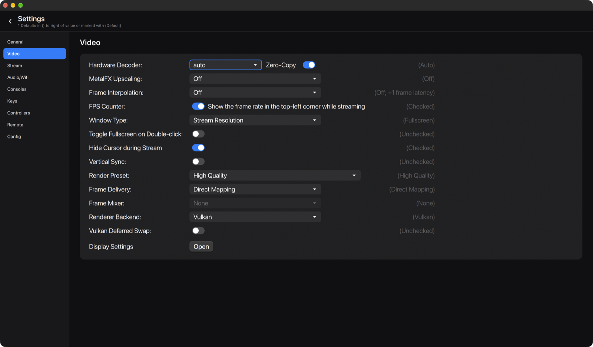
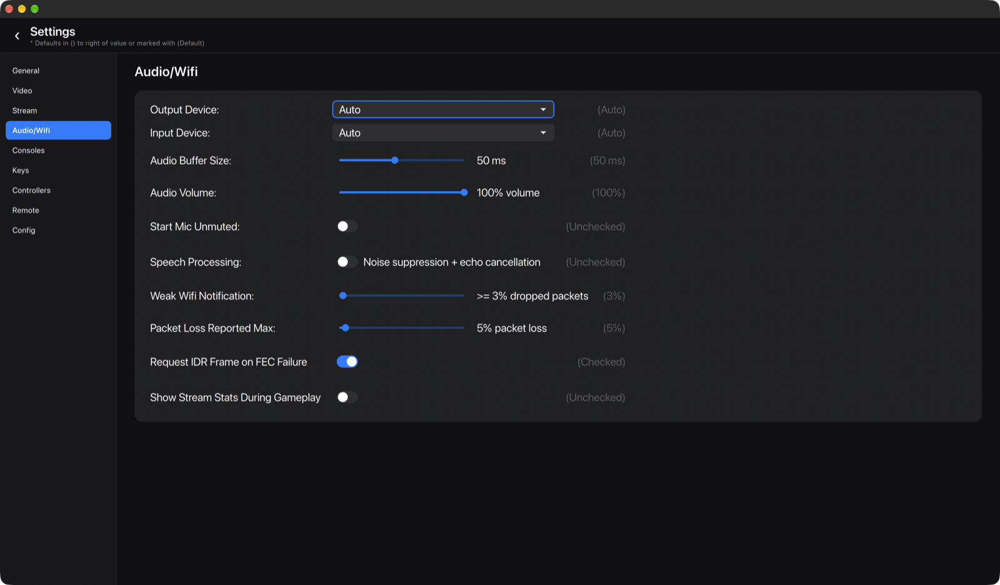

# chiaki-ng macOS 增强版 用户手册

版本：1.10.1-macos-metalfx.1（基于 chiaki-ng 1.10.1，提交 `43728af`）

这个版本在 chiaki-ng 的基础上，为 Mac 增加了苹果原生的画质功能，并重新设计了界面。PS5/PS4 远程游玩的基本用法和原版一样。

---

## 目录

1. [新增功能](#1-新增功能)
2. [系统要求](#2-系统要求)
3. [安装](#3-安装)
4. [第一次使用：注册主机](#4-第一次使用注册主机)
5. [连接与串流](#5-连接与串流)
6. [画质设置详解](#6-画质设置详解)
7. [推荐配置](#7-推荐配置)
8. [键盘与手柄](#8-键盘与手柄)
9. [故障排除](#9-故障排除)
10. [已知限制](#10-已知限制)
11. [卸载](#11-卸载)
12. [源码与反馈](#12-源码与反馈)

---

## 1. 新增功能

| 功能 | 作用 | 默认 |
|---|---|---|
| **插帧**（Frame Interpolation） | 在两帧之间生成中间帧。60fps 串流在 120Hz 屏幕上变成 120fps，画面更顺。可选 VideoToolbox 2x/3x/4x 或 MetalFX 2x | 关 |
| **MetalFX 超分**（MetalFX Upscaling） | 用苹果 MetalFX 把画面放大到窗口大小、2K 或 4K | 关 |
| **帧率显示**（FPS Counter） | 串流时左上角显示实际帧率，开着插帧时还会显示原始帧率和插帧模式 | 开 |
| **解码卡死修复** | 丢包后自动请 PS5 发关键帧。修复了原版在 Mac 上"画面突然定住、再也不动"的问题 | 开 |
| **新界面** | macOS 风格：主机卡片、设置侧边栏、拨动开关、悬浮串流控制条 | — |
| **自动找到 Vulkan** | 不再莫名其妙退回 OpenGL 渲染 | — |

---

## 2. 系统要求

| 项目 | 要求 |
|---|---|
| 电脑 | Apple Silicon Mac（M1 及以后） |
| 系统 | **macOS 27.2 或更新**（安装包里的依赖库是在 macOS 27.2 上编译的） |
| 主机 | PS5，或 PS4 / PS4 Pro |
| 网络 | 主机和 Mac 在同一个局域网；建议 PS5 用网线，Mac 用 5GHz Wi-Fi 或网线 |
| 插帧 | 需要 macOS 26 以上；**屏幕刷新率至少是串流帧率的 1.6 倍才会启用**（例如 120Hz ProMotion 屏配 60fps 串流） |
| MetalFX 超分 | 需要 macOS 13 以上 |

---

## 3. 安装

1. 从 [Releases 页面](https://github.com/JinhaoGu/chiaki-ng/releases) 下载 `chiaki-ng-macos-arm64.dmg`。
2. 双击打开 DMG，把 **chiaki-ng** 拖到 **Applications**（应用程序）文件夹。
3. 第一次打开：这个安装包没有苹果开发者签名，macOS 会拦截。
   - 双击 chiaki-ng，系统提示"无法验证开发者"时，点 **完成**。
   - 打开 **系统设置 → 隐私与安全性**，在页面下方找到"已阻止使用 chiaki-ng"，点 **仍要打开**，输入密码确认。
   - 以后就能正常双击打开了。
   - 如果提示"已损坏，无法打开"，在终端运行下面这条命令，然后再打开：
     ```
     xattr -dr com.apple.quarantine /Applications/chiaki-ng.app
     ```
4. 第一次打开时，macOS 会问"是否允许 chiaki-ng 查找本地网络上的设备"，**必须点允许**，否则找不到也连不上 PS5。

> 漏点了"允许"也没关系：**系统设置 → 隐私与安全性 → 本地网络**，把 chiaki-ng 的开关打开，然后重启 chiaki-ng。

---

## 4. 第一次使用：注册主机

PS5 只接受配对过的设备。配对只需要做一次。

### 方法 A：自动注册（推荐，不需要 PIN 码）

1. 打开 chiaki-ng 后，会弹出"Remote Play via PSN"，点 **Yes**。没弹出的话：**设置 → Remote → Login to PSN**。
2. 在弹出的索尼网页里登录你的 PSN 账号。
3. 回到主界面，PS5 会出现在"Consoles"列表里。点它的 **Connect**，问注册方式时选 **automatic registration**。

### 方法 B：手动注册（PIN 码）

1. 在 PS5 上打开 **设置 → 系统 → 远程游玩 → 链接设备**，屏幕上会显示 8 位数字。
2. 在 chiaki-ng 里点 PS5 的 **Register**，填入 PSN 账号 ID 和这 8 位数字。
3. "Console Pin" 一栏是 PS5 的 4 位开机登录密码，没设过就留空。

### 主界面说明

- 每台主机是一张卡片。绿色"Ready"表示开机可连接，橙色"Rest mode"表示休眠（连接时会自动唤醒）。
- 右上角：刷新 PSN 主机、Steam 快捷方式、手动添加主机（填 IP）、设置（齿轮）。
- "Find consoles on this network" 开关控制是否自动在局域网里搜索主机。

---

## 5. 连接与串流

1. 在主界面点主机卡片上的 **Connect**。
2. 串流开始后：
   - **键盘**：按 **Ctrl+O** 呼出串流菜单。
   - **手柄**：同时按 **L1 + R1 + L3 + R3** 呼出串流菜单（可在 设置 → General 修改组合键）。
3. 串流菜单是屏幕底部的一条半透明控制条，从左到右：
   - 红色 **✕**：断开连接。
   - 音量滑块、**Mic**（麦克风开关）。
   - **Zoom** / **Stretch**：放大填满屏幕 / 拉伸填满屏幕。
   - 画质预设：**Default / High Quality / HQ + Spatial / HQ + Adv Spatial / Custom**。
   - **Display**：显示设置（亮度、HDR 等）。
   - 右侧卡片显示当前码率、连接地址、丢包率。
4. 开启"帧率显示"时，左上角会一直显示帧率，例如：
   - `61 FPS`：没开插帧。
   - `120 FPS / stream 60 · VideoToolbox 2x`：串流 60fps，插帧后显示 120fps。

---

## 6. 画质设置详解

打开 **设置（齿轮）→ Video**：



### 6.1 Frame Interpolation（插帧）

| 选项 | 说明 |
|---|---|
| Off | 关闭 |
| **VideoToolbox 2x** | 苹果视频插帧，每两帧之间插 1 帧。**推荐** |
| VideoToolbox 3x | 每两帧之间插 2 帧（1/3、2/3 处） |
| VideoToolbox 4x | 每两帧之间插 3 帧 |
| MetalFX 2x | 光流 + MetalFX 插帧，每两帧之间插 1 帧 |

需要知道的几点：

- **延迟会增加约 23ms**（60fps 下约 1.4 帧）。插帧必须等下一帧到了才能生成中间帧。玩射击、格斗等反应要求高的游戏时建议关掉。
- **倍数会按屏幕自动封顶**：每次刷新最多显示一帧。120Hz 屏 + 60fps 串流最多 2x；120Hz 屏 + 30fps 串流最多 4x。选了更高的倍数也只按封顶值运行。
- **3x / 4x 在 M3 Pro 上跑不满**：实测 30fps 串流选 4x，只能到约 77fps（目标 120）。电脑算不过来时会自动跳过一部分插帧，不会卡死。日常建议 **60fps 串流 + VideoToolbox 2x**。
- 只支持 **8-bit SDR** 画面。PS5 输出 HDR 时，插帧会自动跳过。
- 画质对比（同一段测试视频）：VideoToolbox 比"重复上一帧"好 10.5dB，MetalFX 好 9.1dB，两者每帧耗时都约 13–14ms。

### 6.2 MetalFX Upscaling（超分）

| 选项 | 说明 |
|---|---|
| Off | 关闭（推荐，用"Render Preset"的放大就够了） |
| Window size | 放大到窗口大小，最高到屏幕物理分辨率 |
| 2K (2560 × 1440) | 固定放大到 2K，最后再缩放到窗口 |
| 4K (3840 × 2160) | 固定放大到 4K，最后再缩放到窗口 |

需要知道的几点：

- 只对 VideoToolbox 解码器有效（Hardware Decoder 保持 `auto` 即可）。
- 窗口比串流画面大时才有意义。在 MacBook 内屏上选 **Window size** 最合适；2K/4K 适合外接大屏。
- 实测客观分数比自带的 **High Quality** 预设略低，肉眼看稍锐。**提升有限**，按个人喜好开。
- 可以和插帧同时开：插出来的帧也会被放大，清晰度一致，实测仍有约 120fps。

### 6.3 FPS Counter（帧率显示）

勾选后，串流时左上角显示帧率。默认打开。

### 6.4 其他常用设置

| 位置 | 设置 | 建议 |
|---|---|---|
| Video | Hardware Decoder | `auto`（Mac 上会用 VideoToolbox） |
| Video | Window Type | `Fullscreen` 全屏；想用可调大小的窗口就选 `Adjust Resolution Manually` |
| Video | Render Preset | `High Quality`（实测放大画质最好） |
| Video | Renderer Backend | `Vulkan` |
| Stream | Resolution / FPS | `1080p` / `60 fps` |
| Stream | Bitrate | 网络好时调到 **30 Mbps** 左右，画质提升最明显；卡顿就往回调 |
| Stream | Codec | `H265` |
| Audio/Wifi | Request IDR Frame on FEC Failure | **保持打开**（防止画面卡死） |



---

## 7. 推荐配置

| 场景 | 分辨率 / 帧率 / 码率 | 插帧 | 超分 | 预设 |
|---|---|---|---|---|
| **日常游玩（推荐）** | 1080p / 60 / 30 Mbps | VideoToolbox 2x | Off | High Quality |
| 竞技、反应要求高 | 1080p / 60 / 30 Mbps | Off | Off | High Quality |
| 画质优先、外接 4K 屏 | 1080p / 60 / 30 Mbps | VideoToolbox 2x | 4K | High Quality |
| 网络一般 | 1080p / 60 / 15 Mbps | Off | Off | Default |

---

## 8. 键盘与手柄

### 手柄

DualSense、DualShock 4 等手柄用蓝牙或 USB 连接 Mac 即可使用。接上手柄后，界面按钮旁会显示对应的手柄按键图标。

### 键盘默认键位

| PS 按键 | 键盘 | PS 按键 | 键盘 |
|---|---|---|---|
| ✕ Cross | Return | ○ Circle | Backspace |
| □ Square | `\` | △ Triangle | C |
| 方向键 | ↑ ↓ ← → | PS | Esc |
| L1 / R1 | 2 / 3 | L2 / R2 | 1 / 4 |
| L3 / R3 | 5 / 6 | Options / Share | O / F |
| Touchpad | T | | |
| 左摇杆 上/下/左/右 | Ins / Del / `[` / `]` | 右摇杆 上/下/左/右 | PgUp / PgDown / `-` / `=` |

在 **设置 → Keys** 可以修改键位，或关闭"Keyboard as controller"。

---

## 9. 故障排除

### 找不到主机 / 连不上（"Network error"、"connect failed"）

几乎都是 **macOS 本地网络权限** 被关了：

1. **系统设置 → 隐私与安全性 → 本地网络**，打开 chiaki-ng。
2. 完全退出 chiaki-ng 再打开。

### 提示 "Remote is already in use"

PS5 认为上一次连接还没结束（比如 chiaki-ng 被强制退出过）。等 10–20 秒再连接即可。

### 画面突然定住，再也不动

原版在 Mac 上丢包后会出现这个问题，本版本已修复：确认 **设置 → Audio/Wifi → Request IDR Frame on FEC Failure** 是打开的（默认打开）。

### 一动就卡、画面断断续续

这是网络丢包（串流菜单右侧会显示丢包率）：

1. PS5 尽量用网线。
2. 暂时关掉 Mac 的 AWDL（隔空投送/接力用的无线通道，会让 Wi-Fi 每隔几秒切换信道）：
   ```
   sudo ifconfig awdl0 down
   ```
   恢复：`sudo ifconfig awdl0 up`（重启电脑也会恢复）。关掉期间隔空投送不能用。
3. 把 **设置 → Stream → Bitrate** 调低。

### 弹出 "Renderer Fallback"，改用了 OpenGL

chiaki-ng 上次启动 Vulkan 时意外退出过，为安全起见改用了 OpenGL。到 **设置 → Video → Renderer Backend** 改回 `Vulkan` 即可。

### 插帧没效果（左上角还是约 60 FPS）

- 屏幕刷新率不够：插帧需要屏幕刷新率至少是串流帧率的 1.6 倍。外接 60Hz 显示器时不会启用。
- PS5 在输出 HDR：插帧只支持 SDR。
- 改了设置后要**重新连接**才生效。

### 超分没效果

- 窗口没有比 1080p 大：全屏或把窗口拉大。
- Hardware Decoder 不是 `auto` / `videotoolbox`。

### 查看日志

**设置 → General → Log Directory → Open**，最新的 `chiaki_session_…log` 就是本次连接的日志。可以搜这些关键词确认功能是否在工作：

| 关键词 | 含义 |
|---|---|
| `Frame interpolation active` | 插帧已生效 |
| `MetalFX upscaling 1920 x 1080 -> …` | 超分已生效，及放大后的尺寸 |
| `Frame interpolation multiplier capped` | 倍数被屏幕刷新率封顶 |
| `Session request connect failed` | 网络/权限问题 |

---

## 10. 已知限制

- 只支持 Apple Silicon、macOS 27.2 以上。
- 安装包没有苹果开发者签名和公证，第一次打开需要在系统设置里点"仍要打开"。
- 插帧会增加约 23ms 延迟；只支持 8-bit SDR；3x/4x 在 M3 Pro 上跑不满。
- MetalFX 插帧只有 2x（MetalFX 只能生成两帧正中间的那一帧）。
- 苹果的机器学习超分（VTSuperResolutionScaler）不支持 1080p 输入，所以没有使用。
- 新界面的字号和控件为桌面尺寸设计，在 Steam Deck/电视上可能偏小。

---

## 11. 卸载

1. 把 **应用程序** 里的 chiaki-ng 移到废纸篓。
2. 如需删除设置和日志：
   ```
   rm -rf ~/Library/Application\ Support/Chiaki ~/Library/Caches/Chiaki
   defaults delete com.chiaki.Chiaki
   ```

---

## 12. 源码与反馈

- 源码：https://github.com/JinhaoGu/chiaki-ng
- 上游项目：https://github.com/chiaki-ng/chiaki-ng
- 本版本由 Claude Code 协助开发。
